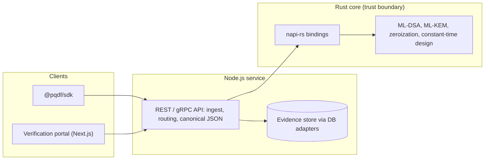
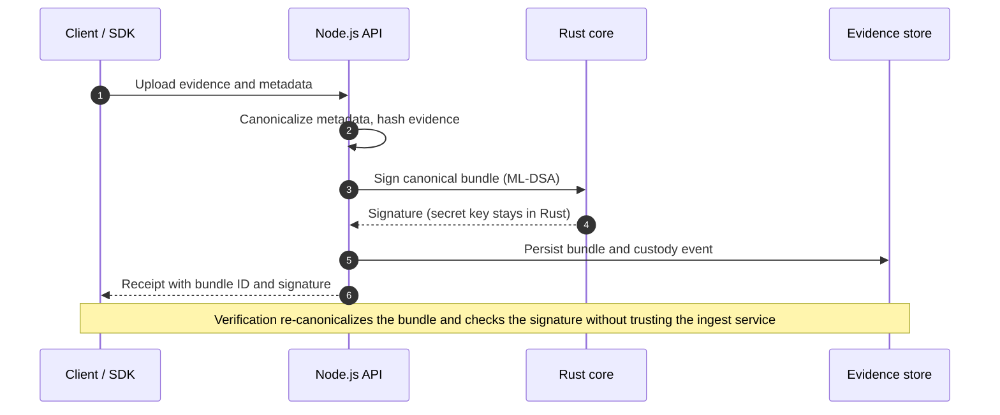

<div align="center">

# pqdf-core

**Open post-quantum signatures for tamper-evident digital evidence**

A Rust cryptographic core (ML-DSA, ML-KEM) with a Node.js service layer, built so that evidence signed today can still be verified, and kept confidential, in the quantum era.


-0A66C2)
-0A66C2)

<!-- Enable once a CI workflow exists:
[](https://github.com/Bona96/pqdf-core/actions)
-->

</div>

> [!WARNING]
> **Pre-alpha and unaudited.** The cryptography in this repository has not been independently reviewed. Do not use it to protect real evidence yet. See [Project status](#project-status) and [THREAT_MODEL.md](THREAT_MODEL.md).

---

## Why this exists

Digital evidence platforms usually sign and encrypt records with RSA or ECDSA. Those schemes are expected to fall to a large quantum computer, and adversaries can already **harvest** encrypted or signed material today and attack it later (Harvest-Now-Decrypt-Later, HNDL). For evidence that must stay trustworthy for years or decades, such as court exhibits, human-rights documentation, or public-sector records, that gap matters now, not in 2035.

Moving to post-quantum cryptography (PQC) is not just a library swap. Implementing lattice-based algorithms directly in JavaScript is risky: JIT compilation and unpredictable garbage collection undermine constant-time execution, which exposes secret-dependent timing to side-channel attacks.

`pqdf-core` takes a different route. **All cryptographic operations live in a Rust core**, and JavaScript only orchestrates: it handles ingest, canonical serialization, routing, and verification workflows, but it is not trusted with the primitives.

## Design principles

1. **Keep crypto out of the JavaScript runtime.** Rust gives memory safety and control over zeroization, and makes constant-time design practical to test.
2. **Standards first.** ML-DSA (FIPS 204) for signatures and ML-KEM (FIPS 203) for key encapsulation. No home-grown schemes.
3. **Deterministic, canonical evidence.** A signature is only meaningful if everyone agrees on exactly which bytes were signed.
4. **Algorithm agility.** Every signature records its algorithm, so evidence can be re-signed when something breaks or a better scheme arrives.
5. **Independent verification.** Anyone should be able to verify a bundle without trusting the service that ingested it.
6. **Honest claims.** Properties are marked *designed*, *tested*, or *audited*, and only upgraded when the evidence exists.

## Architecture



| Layer | Responsibility | Trusted with key material? |
| :-- | :-- | :-- |
| **Rust core** | ML-DSA signing/verification, ML-KEM encapsulation, key generation, zeroization | Yes (design goal: secret keys never enter the JS heap) |
| **napi-rs bindings** | Native Node.js addon exposing a minimal, opaque API; heavy lattice work does not block the event loop | Only passes handles and byte buffers |
| **Node.js service** | REST and gRPC endpoints, deterministic JSON serialization, evidence ingest, routing, PQC timestamp verification | No |
| **Clients** | `@pqdf/sdk` and the verification portal | No |

### Ingest and verify flow



### Evidence bundle (illustrative draft)

The normative format will be defined in `docs/SPEC.md` during Milestone 0 and Milestone 1. This sketch shows the intended shape.

```jsonc
{
  "version": "0.1",
  "evidence": { "hash_alg": "sha3-256", "hash": "…", "size": 1048576 },
  "metadata": { "collected_at": "…", "collector": "…", "case_ref": "…" },
  "custody": [
    { "event": "ingest", "actor": "…", "at": "…", "prev": null }
  ],
  "signatures": [
    { "alg": "ML-DSA-65", "key_id": "…", "sig": "…" }
  ],
  "timestamp": { "type": "…", "token": "…" }
}
```

`signatures` is an array on purpose: it allows hybrid (classical plus PQC) signing during migration and re-signing later without rewriting history.

## Algorithms

| Algorithm | Standard | Role in `pqdf-core` | Status |
| :-- | :-- | :-- | :-- |
| ML-DSA | FIPS 204 | Evidence and custody-record signatures | Milestone 1 |
| ML-KEM | FIPS 203 | Encapsulating keys to protect evidence in transit and at rest | Milestone 1 |
| SLH-DSA | FIPS 205 | Hash-based signatures for long-lived roots of trust | Under consideration |
| Ed25519 + ML-DSA (hybrid) | n/a | Defence in depth during the transition period | Under consideration |

## Project status

| Area | State |
| :-- | :-- |
| Rust core (ML-DSA, ML-KEM) | In development |
| Constant-time behaviour | *Designed for*. Timing tests are planned, not yet run |
| Independent security audit | None |
| Canonical serialization spec | Milestone 1 |
| Production use | **Not recommended** |

## Roadmap

- [ ] **Milestone 0: Foundations.** `THREAT_MODEL.md`, `SECURITY.md`, licence, CI, and a draft evidence-bundle spec with test vectors.
- [ ] **Milestone 1: Rust core.** ML-DSA and ML-KEM bindings, plus the Canonical Serialization Specification.
- [ ] **Milestone 2: Service layer.** Node.js microservice, gRPC API endpoints, and database adapters.
- [ ] **Milestone 3: Verification.** Independent Next.js verification portal and the lightweight `@pqdf/sdk` client package.
- [ ] **Milestone 4: Hardening and delivery.** Automated fuzzing, hardware memory benchmarking, and Docker image deployment.
- [ ] **Beyond:** hybrid signatures, periodic re-timestamping for long-term validity, a Merkle-tree custody log with signed tree heads, a WASM verifier, and SLH-DSA support.

## Testing and assurance plan

These are planned, and each will be checked off here once it exists:

- [ ] NIST known-answer tests (ACVP vectors) for ML-DSA and ML-KEM
- [ ] Differential tests against a second, independent implementation
- [ ] Constant-time checks with dudect-style statistical timing tests in CI
- [ ] `cargo-fuzz` targets for parsers, deserializers, and the FFI boundary
- [ ] `cargo audit` and `cargo deny` in CI, plus a published SBOM
- [ ] Zeroization tests for secret buffers
- [ ] Memory and latency benchmarks on commodity hardware
- [ ] Independent third-party security review

## Standards and context

- **NIST:** FIPS 203 (ML-KEM), FIPS 204 (ML-DSA), FIPS 205 (SLH-DSA)
- **Digital evidence handling:** ISO/IEC 27037 (identification, collection, acquisition, preservation)
- **Timestamping and long-term evidence:** RFC 3161, RFC 4998 (Evidence Record Syntax)
- **Canonical JSON:** RFC 8785 (JCS)
- **Legal context (Uganda):** Electronic Signatures Act 2011, Electronic Transactions Act 2011, Computer Misuse Act 2011. A short mapping of how this design relates to evidential requirements is planned in `docs/LEGAL.md`. It is not legal advice.

## Getting started

```bash
git clone https://github.com/Bona96/pqdf-core.git
cd pqdf-core
cargo test        # build and test the Rust core
```

Service and SDK setup instructions will be added as Milestones 2 and 3 land.

## Security

Please do **not** open public issues for suspected vulnerabilities. Use GitHub's private vulnerability reporting for this repository, or see [SECURITY.md](SECURITY.md). Read [THREAT_MODEL.md](THREAT_MODEL.md) to understand what is and is not in scope.

## Contributing

Contributions, reviews, and critiques are very welcome, especially from cryptographers and forensic practitioners. Open an issue to discuss before large changes. A `CONTRIBUTING.md` will describe the workflow.

## License

Licensed under either of [Apache License 2.0](LICENSE-APACHE) or [MIT license](LICENSE-MIT) at your option.

## Author

Built by [Nuwabiine Bonaventure](https://github.com/Bona96) as part of M.Sc. research in Cybersecurity and Digital Forensics.